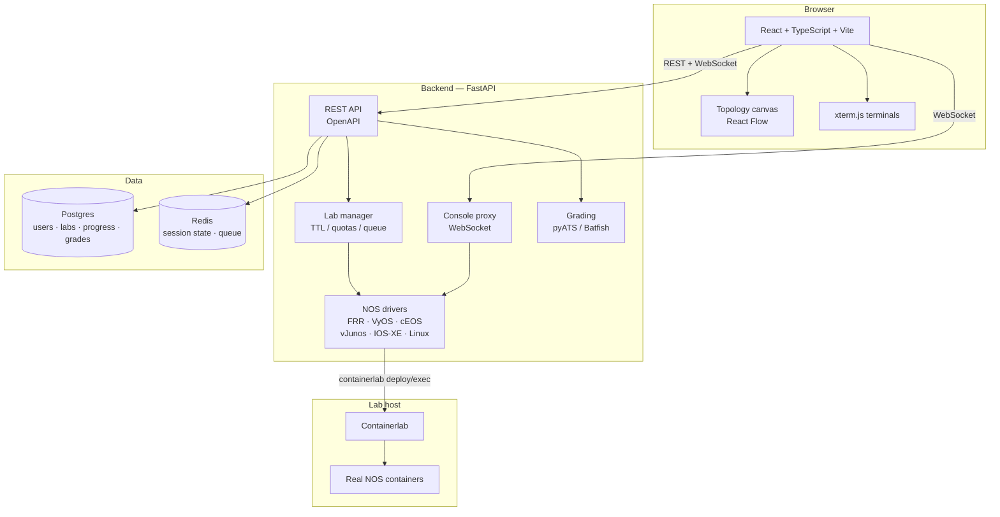

# netlab-platform

A browser-based network lab platform for studying and coursework — with **real
emulation, real packets, and real configs**. Not a CLI simulator.

Open a topology in the browser, boot real network OS nodes, and get live
console access to each device. Labs are declared as code, graded automatically
against live state, and tracked per student.

> **This is not SwitchLab.** SwitchLab simulates CLIs in the browser. This
> platform orchestrates real NOS containers with
> [Containerlab](https://containerlab.dev) — FRR, VyOS, Arista cEOS, Juniper
> vJunos, Cisco IOS-XE, and Linux hosts — so `show ip ospf neighbor` returns
> output from a real routing daemon, and a packet you send traverses real
> virtual interfaces.

## Architecture



## Quick start

### Prerequisites

- Docker + [Containerlab](https://containerlab.dev/install/) on the host that
  runs labs (the API drives them through the Docker socket)
- Python 3.12+, Node 20+
- For Cisco IOS-XE, Arista cEOS, or Juniper vJunos: your own image, supplied
  under your own license — see [BYO-image guide](docs/byo-image-guide.md)

### Run it

```bash
# One-time setup (checks deps, creates venv, installs packages)
./scripts/dev-setup.sh

# Start everything
docker compose up --build
```

- Web UI: http://localhost:5173
- API + OpenAPI docs: http://localhost:8000/docs

### Deploy the sample lab

1. Sign in (GitHub OAuth, or dev mode) and open **Labs**.
2. Open **Two-Router OSPF with a VLAN-Aware Switch**.
3. Click **Deploy**. Each node gets a live terminal tab.
4. Work the guide in `labs/ospf-two-router/guide.md`, then click **Run checks**
   to grade the objectives against live state.

## Repo layout

```
netlab-platform/
├── apps/
│   ├── api/            # FastAPI backend (auth, labs, console proxy, grading, db)
│   └── web/            # React + TS + Vite frontend (canvas, terminals, objectives)
├── packages/
│   ├── drivers/        # Pluggable NOS driver interface + FRR/VyOS/cEOS/vJunos/IOS-XE/Linux
│   ├── topology/       # Containerlab YAML load / validate / generate
│   └── shared/         # Shared types and errors
├── labs/               # Coursework: one directory per lab (topology + objectives + guide)
├── infra/
│   ├── helm/           # Hosted deployment chart
│   └── terraform/      # Hosted deployment (single Docker host)
├── docs/               # Architecture, BYO-image guide, instructor guide, API
└── .github/workflows/  # CI, topology validation, image publish
```

## Network OS support

| Driver | Image | How you get it |
|---|---|---|
| FRR | `quay.io/frrouting/frr-containerlab:10.7.1` | Public registry, pulled automatically |
| Linux hosts | `alpine:3.20` | Public registry, pulled automatically |
| VyOS | user-built `vyos-runtime:<version>` | Build from a nightly ISO — see `scripts/build-vyos-image.sh` |
| Arista cEOS | BYO | Download from arista.com under your account, upload via the UI |
| Juniper vJunos-switch | BYO | Download from juniper.net under your account, upload via the UI |
| Cisco IOS-XE | BYO | Your own image, uploaded via the UI — see [BYO-image guide](docs/byo-image-guide.md) |

**No proprietary image is bundled, downloaded, or linked by this project.**
Uploads are verified with SHA256 and require an explicit license
acknowledgement. See [docs/byo-image-guide.md](docs/byo-image-guide.md).

## Coursework and grading

Labs live in `labs/<slug>/` with three files:

- `topology.clab.yml` — Containerlab topology (nodes, kinds, images, links)
- `lab.yml` — objectives, each with an automated check
- `guide.md` — step-by-step student guide

Checks run against **live state** via pyATS/Genie (`show` commands on the
running node) or Batfish (config analysis). Results are stored per student
and visible on the instructor dashboard.

## Development

```bash
# Python tests (drivers, topology, API)
pytest packages/drivers/tests packages/topology/tests apps/api/tests

# Validate every lab's YAML (also runs in CI on PRs touching labs/)
python scripts/validate-topologies.py

# Frontend typecheck + build
cd apps/web && npm run typecheck && npm run build

# Playwright E2E
cd apps/web && npx playwright test
```

## Security model

- One isolated Containerlab lab per user session; per-session network
  isolation; no shell escape from node consoles into the host (all
  Containerlab/Docker calls use argument lists, never `shell=True`).
- Uploads are sanitized (extension allowlist, size cap, SHA256 verification).
- API routes are rate-limited; instructor and student roles are enforced
  server-side; console sessions are logged, with a read-only observer mode
  for instructors.

See [docs/architecture.md](docs/architecture.md) for the full design.

## License

MIT — see [LICENSE](LICENSE). Third-party NOS images remain property of their
vendors; see the license notice in [LICENSE](LICENSE) and
[docs/byo-image-guide.md](docs/byo-image-guide.md).
