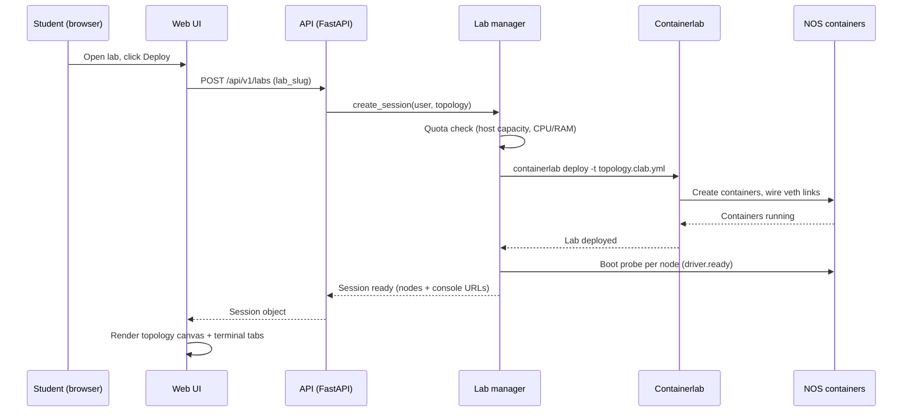
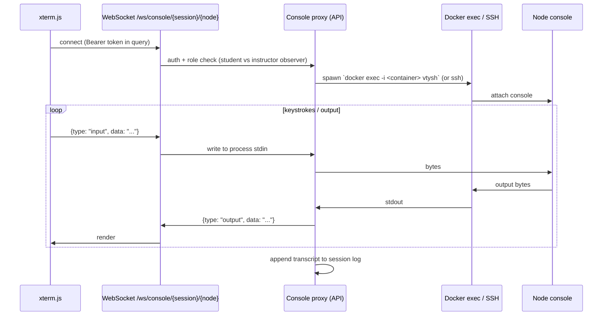
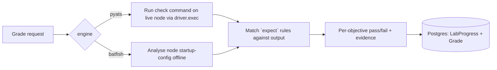

# Architecture

## Overview

netlab-platform is a monorepo with three deployable pieces:

| Piece | Stack | Runs where |
|---|---|---|
| `apps/web` | React + TypeScript + Vite, React Flow, xterm.js | Browser (static, served by nginx) |
| `apps/api` | Python + FastAPI | Host with Docker + Containerlab |
| `packages/*` | Python libraries (drivers, topology, shared) | Imported by the API |

Postgres stores users, lab sessions, progress, and grades. Redis stores
ephemeral session state and the deploy queue. Containerlab runs on the lab
host and owns the actual network namespaces, interfaces, and containers.

## Request flows

### Deploy a lab

### Console session

The proxy never gives the browser a shell on the host. It spawns exactly one
command per node, chosen by the node's driver (`console_command`), with an
argument list — never `shell=True`. Reconnect is a fresh attach; the previous
process is reaped. Instructors may join in read-only observer mode
(`?observer=1`): input frames are dropped server-side.

### Grading

pyATS checks run `show` commands on the live node and match the `expect`
mapping (substring or regex) against the output. If Genie is installed, the
runner tries `genie parse` first and matches against the parsed structure,
falling back to text matching. Batfish checks analyse the node's rendered
startup-config without traffic (e.g. "ACL blocks 10.0.0.0/8 from VLAN 20").

## Sessions, TTL, and quotas

- One Containerlab lab per user session: namespace
  `netlab-<user_id>-<lab_slug>-<short_id>`.
- Default TTL 2 hours from deploy; idle timeout 30 minutes (no console input
  and no API activity); a background reaper destroys expired sessions.
- Per-lab quotas from the topology (default 4 vCPU / 4096 MB per lab, 1 vCPU /
  512 MB per node). The lab manager refuses new deploys when the host is
  full and queues the request FIFO; the client polls queue position.
- `snapshot` captures each node's running config via its driver;
  `reset` re-deploys the lab from its declared topology.

## Driver model

See `packages/drivers/netlab_drivers/base.py`. One driver per NOS, with five
defining attributes (image, default credentials, boot-ready probe, console
method, startup-config template) and lifecycle methods (`startup_config`,
`ready`, `exec`, `console_command`, `snapshot`). The orchestrator never
imports a vendor SDK directly — it only calls the driver interface. Adding a
vendor is one file plus one registry line.

## Auth

GitHub OAuth first, Google second. OAuth is a stub until client credentials
are configured (`OAUTH_*` in `.env`): the authorize/callback routes exist
and perform the real code exchange, but return 503 "OAuth not configured"
without credentials. Roles: `student`, `instructor`, `admin`. JWTs (HS256)
carry the role; instructor-only routes enforce it server-side.

## Observability

- Structured JSON logs (stdlib logging, one line per request/event).
- Prometheus metrics at `/metrics`: `netlab_labs_running`,
  `netlab_lab_boot_seconds` (histogram, per driver), `netlab_console_latency`,
  `netlab_grade_checks_total`.
- Tracing: request IDs propagated in logs (`X-Request-ID`).

## Deployment shapes

| Shape | How | Notes |
|---|---|---|
| Local dev | `docker compose up` | API drives host Docker + Containerlab via socket mount |
| Single hosted host | `infra/terraform` + `infra/helm` | One Docker host; same Compose topology under k8s |
| Scale-out | Multiple lab hosts behind the API | Lab manager becomes host-aware (future work; queue is the seam) |

The API container does **not** run Containerlab inside itself in production;
it shells out to the host binary. That keeps the container small and the lab
namespaces on the host where Docker lives.
